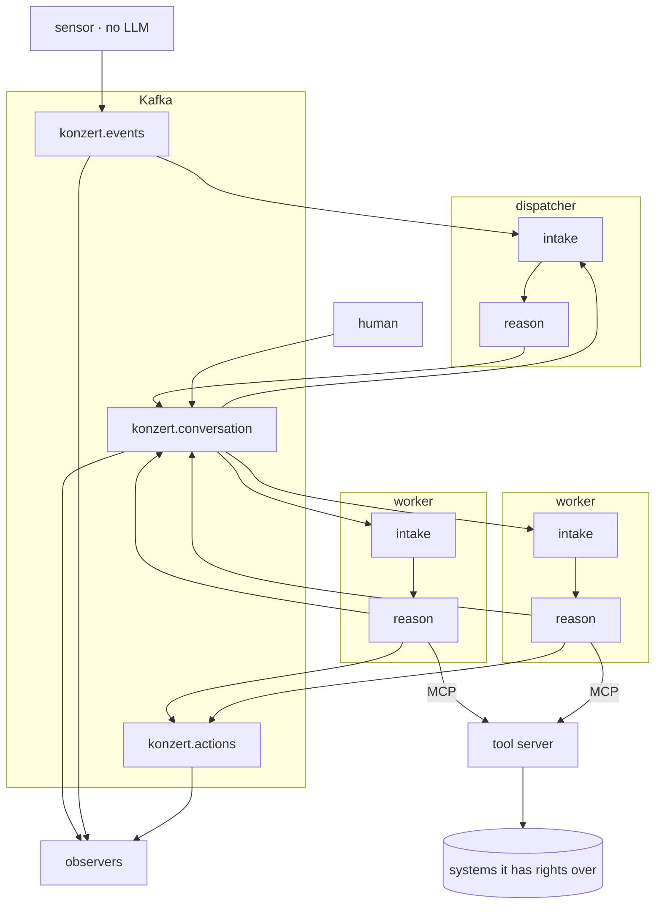

# Architecture

Decisions are recorded as ADRs in [docs/adr/](docs/adr/). This page is the map.

## Principles

- **Event-first.** Agents collaborate by publishing and consuming messages.
  They never call each other.
- **Filter before you reason.** Tokens are spent on purpose, never by
  subscription.
- **Deterministic where it matters.** Detection, filtering, budgets, approval
  matching and the catalogue of allowed actions are code and configuration. The
  model decides *what to say and what to propose*, inside those bounds.
- **No agent holds the keys.** Rights over real systems belong to tool servers,
  not to agents.
- **A human can always see, and can always stop.** The conversation is on a
  topic; autonomy is a setting.
- **Configuration is data in the cluster.** Not files in an image, not state on
  a volume.

## The pieces



### The bus

Three topics ([messages.md](docs/messages.md)):

- **events**: facts, produced by sensors that contain no model.
- **conversation**: the dialogue. Agents, and people, speak here. A message
  names its addressees (`to`) and what kind of turn it is (`intent`).
- **actions**: what was actually executed and what came back. The audit trail.

Every message is a CloudEvent with a correlation ID
([ADR-0002](docs/adr/0002-event-governance.md)). The correlation ID is also the
record key, which is what the scaling model rests on
([ADR-0010](docs/adr/0010-scaling-model.md)).

### An agent

Every agent, whatever it does, is the same four things from
[`core`](core):

```
Kafka ──▶ intake filter ──▶ your handler ──▶ LLM ──▶ Kafka
              ▲                  ▲
              └── configuration ─┘      (ConfigMap + Secret, watched)
                      ▲
              Control Panel API
```

- **`KafkaBus`** consumes in the agent's consumer group and publishes keyed
  records. It filters nothing, so the "seen" counter is honest.
- **`IntakePipeline`** decides, with no model, whether a message is dropped,
  counted, or allowed to cost something
  ([agent-control-panel.md](docs/agent-control-panel.md)).
- **`LlmClient`** calls any OpenAI-compatible endpoint, with a timeout, and
  reports token usage back to the budgets. A failed or empty call is reported
  as such, never as content.
- **`ConfigStore`** merges code defaults, a seeded ConfigMap/Secret and a
  runtime ConfigMap/Secret, watches them, and notifies the agent on change.
  `ConfigResource` exposes it over HTTP.
- **`AgentRuntime`** wires those together and tracks which incidents are open.

### The dispatcher and the workers

The reference pattern is one dispatcher and several workers.

**Maestro** ([agents/maestro](agents/maestro)) hears facts and the conversation.
It decides who owns a new incident, answers people, and declares incidents
closed. It has no tools at all: the agent that decides is structurally unable
to act.

**A worker** ([agents/worker](agents/worker)) owns a domain. It hears only the
conversation, and reasons about what is addressed to it or to everyone. It acts
by asking an MCP server to run a playbook from a closed catalogue, and it
refuses a playbook the catalogue does not assign to it. One image serves every
worker; identity, soul, filter and autonomy are configuration.

### The tool server

An MCP server holds the rights (its ServiceAccount, not the agent's) and offers
a fixed list of things that can be asked of it. In the example that is
[mcp-ansible](examples/incident-response/mcp-ansible): a handful of reviewed
playbooks baked into the image, each restricted to an allowed namespace. An
agent cannot ask for an arbitrary playbook, a path or a shell command.

### People

A person is a participant on the conversation topic with the name `human`. They
can ask the dispatcher anything, at any time. When a worker in `propose` mode
wants to change something, it addresses its plan to `human` and waits; the
answer is a message, matched against a fixed list of words
([messages.md](docs/messages.md#human-approval)).

## What stops it from running away

A conversation between models on a bus can loop, and loops cost money. None of
the following is asked of the model; all of it is enforced before or around it:

| Mechanism | Where |
|---|---|
| nothing becomes an event until a sensor's rule fires | the sensor |
| default deny; an agent never matches its own messages | intake, stages 1 and 2 |
| the same fact again within a window is not new | intake, dedup |
| a turn budget per correlation ID | intake, correlation |
| a limit on incidents in flight | intake, correlation |
| events per minute, calls and tokens per hour | intake, budget |
| an `ack` or `observe` is remembered and never answered | the agents |
| a timeout on every model call, and a fixed fallback line | `LlmClient`, the agents |
| an incident nobody closed is released after an idle period | the agents |
| a mutating action waits for a person, by default | the worker, `propose` |

## Deployment

One Helm chart ([deploy/helm/agent](deploy/helm/agent)) is installed once per
agent, with a values file that carries its identity, model and filter. It
creates a ServiceAccount, a Role limited to the agent's own configuration
objects, the seeded ConfigMap, a Deployment and a Service. The model key is not
in the chart: it is a Secret you create.

Scaling a role is a replica count on that chart
([scaling.md](docs/scaling.md)), with the caveats listed there.

## Boundaries of the project

Konzert is the collaboration layer. Sandboxing an agent's execution and
operating a fleet of agents are neighbouring problems that other projects
address ([ADR-0009](docs/adr/0009-konzert-scope-and-positioning.md)).
