# Konzert

**An event-driven multi-agent framework for OpenShift.** AI agents with
different jobs collaborate over Kafka, with a default-deny filter in front of
every model, no direct access to the infrastructure they act on, and human
approval built in.

*Konzert* is German for concert: several players, one piece, a conductor.

> **Status: early and experimental.** This code was extracted from a working
> demo that ran on a real cluster. In this repository it builds and passes its
> unit tests, but the extracted version has not yet been re-run end to end.
> APIs, message formats and names can change, and important parts are not built
> yet. Read [what works and what does not](#what-works-today-and-what-does-not)
> and [SECURITY.md](SECURITY.md) before running it anywhere that matters.

## The idea

Most agent frameworks connect agents to each other with function calls or
point-to-point protocols. Konzert connects them the way teams of services are
connected: with a bus.



The structure has four parts: a **sensor** that states facts and contains no
model, **Maestro** the dispatcher, the **agents** that each own a domain, and
the **bus** that is the only thing connecting them. Atlas and Sentinel are two
examples of the agent role, the same image with different configuration. The
third box is yours.

Four rules follow from that picture, and they are the framework:

1. **Agents talk on Kafka and nowhere else.** Every message is a CloudEvent
   with a correlation ID. Any agent can react to a message meant for the room,
   an observer can watch without being wired into anything, and yesterday's
   incident can be replayed.
2. **Subscribing is not reasoning.** Between a topic and a model sits an
   *intake filter*: deterministic, zero tokens, default deny. An agent reasons
   only about what a rule admits, within budgets enforced in code. You can read
   the filter, change it while the agent runs, and see what it has been doing.
3. **Agents have no hands of their own.** An agent holds no credentials for the
   systems it changes. It calls an [MCP](https://modelcontextprotocol.io)
   server, which holds the rights and offers a closed catalogue of actions.
4. **A person can be in the loop without being in the way.** In `propose` mode
   an action that changes something waits for approval. The approval is a
   message on the same bus, matched without a model.

## What is in the box

| | |
|---|---|
| [`core/`](core) | the library every agent is built on: Kafka bus, CloudEvents, intake filter, LLM client, runtime configuration in Kubernetes objects, and the Control Panel API |
| [`agents/maestro/`](agents/maestro) | the dispatcher: triages facts, delegates, talks to people, closes incidents. It has no tools |
| [`agents/worker/`](agents/worker) | one image for every worker: an agent that owns a domain and acts through playbooks on an MCP server. Identity, soul, filter and catalogue are configuration |
| [`deploy/helm/agent/`](deploy/helm/agent) | one chart, installed once per agent |
| [`deploy/kafka/`](deploy/kafka) | a minimal Kafka cluster and the three topics |
| [`examples/incident-response/`](examples/incident-response) | the reference example: Maestro, **Atlas** (infrastructure) and **Sentinel** (security) resolve two real incidents on a cluster, with a sensor, an Ansible MCP server and a live panel |
| [`examples/minimal-agent/`](examples/minimal-agent) | the smallest useful agent, under a hundred lines, as a starting point |

Built with Quarkus and Java 25. Kafka through Strimzi, models through any
OpenAI-compatible endpoint, tools through MCP, automation through Ansible,
packaging through Helm.

## What works today, and what does not

| Works | Not yet |
|---|---|
| Agents collaborating over three Kafka topics, keyed by correlation ID | Durable per-incident state: it is in memory, so more than one replica per agent is experimental |
| Intake filter: subscriptions, ordered rules, dedup, turn budget, concurrent-incident cap, call and token budgets | Triage lane, deterministic handlers and debounce: configurable, counted, not wired |
| Funnel, per-message verdicts with reasons, dry run against real traffic | A web UI for the Control Panel: it is a REST API today |
| Runtime configuration in ConfigMaps and Secrets, hot reload, seed and runtime layers | **Authentication** on the Control Panel API and on the example's panel |
| Human approval as a message, matched deterministically | Kafka authentication and per-agent ACLs |
| Workers that can only run playbooks from a closed catalogue | An agent registry, several teams ("rooms"), an agent CRD and operator |
| The incident-response example: sensor, three agents, Ansible MCP server, panel | Schema registry, an A2A edge adapter, an Ansible Automation Platform backend |

The plan for the right-hand column is in [ROADMAP.md](ROADMAP.md).

## Try it

Build and test everything (Java 25, Maven):

```bash
mvn verify
```

Run the reference example on an OpenShift cluster you can throw away:
[examples/incident-response/docs/install.md](examples/incident-response/docs/install.md).
A two-incident run costs cents in tokens.

## Write an agent

Most new agents need no code: a worker is a soul, a values file and the
playbooks it may run. When you do need code, an agent is one class on top of
`konzert-core`. Both paths are in
[docs/building-an-agent.md](docs/building-an-agent.md).

## Documentation

- [docs/concepts.md](docs/concepts.md): the vocabulary
- [ARCHITECTURE.md](ARCHITECTURE.md): how the pieces fit
- [docs/messages.md](docs/messages.md): the message contract
- [docs/agent-control-panel.md](docs/agent-control-panel.md): the intake filter and the configuration API
- [docs/scaling.md](docs/scaling.md): roles, replicas, and the limits today
- [docs/building-an-agent.md](docs/building-an-agent.md): adding an agent
- [docs/adr/](docs/adr): why things are the way they are
- [docs/extraction-notes.md](docs/extraction-notes.md): the state of the repository after its first extraction, and what is next
- [SECURITY.md](SECURITY.md): known limitations, and how to report a problem
- [CONTRIBUTING.md](CONTRIBUTING.md) and [AGENTS.md](AGENTS.md): how to contribute, for people and for coding agents

## How it relates to other projects

Konzert is the collaboration layer and nothing else. It does not sandbox an
agent's execution and it is not a platform for deploying and governing agents;
other open-source projects do those, and the intent is to integrate with them
rather than rebuild them. The reasoning is in
[ADR-0009](docs/adr/0009-konzert-scope-and-positioning.md).

## License and disclaimer

Apache License 2.0. See [LICENSE](LICENSE).

Konzert is an independent, community project. It is not a product of, and is
not supported or endorsed by, Red Hat or any other company or project mentioned
in this repository. OpenShift is a trademark of Red Hat, Inc.; Apache Kafka is a
trademark of the Apache Software Foundation. Other names are the property of
their owners.
