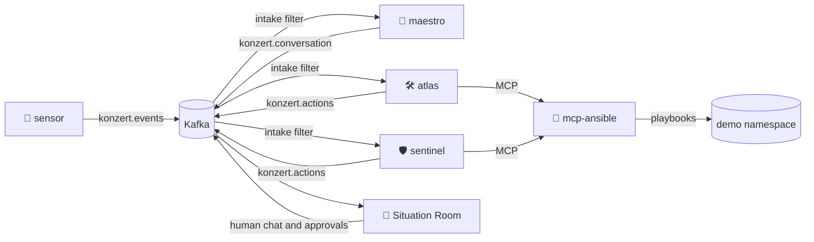

# Example: an incident-response team

Three agents with different jobs detect, discuss and fix two real incidents on
an OpenShift cluster, while a person watches the conversation and approves the
risky steps. It is the reference example for Konzert: every framework feature
in [the root README](../../README.md) is exercised here.

Everything you see on the panel is a real Kafka message. Every fix is a real
Ansible playbook run against the cluster.

## The demo, in one screen

The **Situation Room** (`konzert-console`) is a single page:

```
┌──────────────────────────────────────────────────────────────────┐
│  💣 Inject: [ memory leak ]  [ port scan ]  🧹 Clear  ⏹ Revert  │
├──────────────────────────────────────────────────────────────────┤
│  📡 sensor      MemoryPressureDetected · checkout-api · 1.8 GiB  │
│                 no memory limit on the deployment                │
│  🎼 maestro     That is a workload ownership problem. Atlas?     │
│  🛠️  atlas      Proposed: set-deployment-limits.yml  [✅] [⛔]   │
│                 ▸ ansible output (12 tasks, 0 failed)            │
│  🛠️  atlas      Limits applied (256Mi/1Gi), rollout complete.    │
│  🎼 maestro     Confirmed, memory flat for 30s. Incident closed. │
├──────────────────────────────────────────────────────────────────┤
│  💬 you: why not just restart the pod?                           │
└──────────────────────────────────────────────────────────────────┘
```

## Cast

| | Component | Owns | Hands |
|---|---|---|---|
| 📡 | **Sensor** (no LLM) | turning cluster reality into events | metrics API, pod logs (read-only) |
| 🎼 | **Maestro**, the dispatcher | triage, delegation, closing incidents, talking to people | Kafka only |
| 🛠️ | **Atlas**, infrastructure | Deployments, resources, rollouts | Ansible, through MCP |
| 🛡️ | **Sentinel**, security | NetworkPolicies, isolation | Ansible, through MCP |
| 📜 | **mcp-ansible** (no LLM) | the closed playbook catalogue | the only ServiceAccount allowed to change the namespace |
| 💬 | **Situation Room** (no LLM) | showing the bus, injecting the problems | chaos manifests only |

Atlas and Sentinel are the **same image** ([agents/worker](../../agents/worker)).
What makes one infrastructure and the other security is configuration: a
[soul](souls/), a values file with its identity and intake rules, and which
playbooks the catalogue says it owns.



## The two incidents

1. **Memory leak with no limits.** A workload allocates memory until the node
   hurts, and its Deployment declares no `resources.limits`. Atlas proposes a
   playbook that sets limits, waits for approval, runs it and waits for the
   rollout.
2. **Port scan from a compromised pod.** A workload starts sweeping TCP ports.
   Sentinel isolates it with a NetworkPolicy, then tells everyone what the
   policy selects. Atlas, who was not addressed by Maestro, checks that the
   legitimate workload is still healthy. This is the incident that shows why
   the transport is a bus.

## Human in the loop

Atlas and Sentinel ship with autonomy `propose`: a playbook that changes the
cluster is not run until the operator approves it. The agent posts its plan to
`human` as an `ask` on `konzert.conversation`. The Situation Room renders
**Approve** and **Deny** under that message, and the click is itself a Kafka
message (`intent: answer`) under the same correlation ID. The verdict is
matched without a model. Read-only playbooks never wait.

Set an agent to `act` and the same demo runs with no human at all.

## Documentation

- [docs/install.md](docs/install.md): step-by-step installation
- [docs/architecture.md](docs/architecture.md): components, topics, message
  contract, loop control, RBAC
- [docs/demo-script.md](docs/demo-script.md): an eight-minute walkthrough, and
  what to do when it misbehaves

Decision record: [ADR-0006](../../docs/adr/0006-incident-response-example.md).

## Layout

```
examples/incident-response/
├── souls/             # who Maestro, Atlas and Sentinel are (one Markdown file each)
├── sensor/            # cluster reality -> konzert.events (no LLM)
├── console/           # the Situation Room, plus the chaos injector
├── mcp-ansible/       # MCP server exposing the playbooks as tools
│   └── ansible/       # the playbooks, baked into that image on purpose:
│                      # the closed catalogue IS the security boundary
├── chaos/             # the victim workload
├── deploy/helm/       # charts for sensor, console and mcp-ansible,
│                      # and values-{maestro,atlas,sentinel}.yaml for the agent chart
├── hack/              # build-all.sh · build-layered.sh · install.sh · reset.sh
└── docs/
```

The agents themselves live at the repository root: [agents/maestro](../../agents/maestro),
[agents/worker](../../agents/worker), and the chart in
[deploy/helm/agent](../../deploy/helm/agent).

## Before you expose anything

This is a demo. The Situation Room has **no authentication**: anyone who can
reach its Route can inject the incidents, talk to Maestro and approve a
playbook. Run it on a throwaway cluster or behind an authenticating proxy, and
read [SECURITY.md](../../SECURITY.md) first.
